# Confidence-aware Facebook Page Classification with a GCN

**Yuhan Liao - 49839991 | COMP3710, Semester 2, 2026 | Report revision: 29 October 2026**

**Selected project:** Multi-layer GNN, Normal difficulty.

**Update: 26 October 2026.** Feasibility check-off completed (student-confirmed). The original 21 October training runs and 90% policy are preserved. A separate, frozen 97% policy follow-up is now implemented and reported in Section 6 as post-hoc original-test reuse, not independent confirmation. A further CPU robustness study uses five disjoint label roles and separately fitted class thresholds; its same-graph limitations are explicit. Exact confidence-boundary search now repairs a coarse-grid coverage limitation; a three-seed weighted-loss ablation and optional random quality review are also recorded. A final fixed six-model averaging/disagreement ablation and selected-error graph sensitivity check extend the confidence investigation, with negative outcomes and extra CPU cost retained. Colab remains the original baseline snapshot.

## 1. Purpose and principal findings

This Facebook-page classification assistant combines 128-dimensional page features and connections using a two-layer graph convolutional network (GCN). It predicts television-show, government, company or politician labels. A matched feature-only multilayer perceptron (MLP) tests graph context's value. The engineering question is whether classification and confidence gains justify additional cost, and whether uncertainty can guide human review.

Across three initialisations on one fixed split, GCN reaches **93.84% test accuracy**, versus **80.77% for MLP**, a **13.07 percentage-point** gain. GCN Macro-F1 is 0.9333 versus 0.7884. Nevertheless, very confident mistakes remain. The original fitted GCN threshold is zero, accepting every case: it meets the original 90% empirical accuracy target but fails to provide useful ambiguity routing. A 26 October follow-up raises the calibration acceptance target to 97% while preserving the models and temperatures. On the previously inspected original test, mean referral is 10.74% and accepted-case accuracy is 97.07%; whole-test classification accuracy remains 93.84%. One seed reaches only 96.99%. This is a promising routing extension, not an independently confirmed deployment policy. A further, prospectively fixed within-graph study separates temperature/policy fitting and evaluates a class-aware alternative; Section 6 reports its gains and class-coverage cost without replacing the original results, followed by the exact-search repair, weighted recall/precision trade-off and fixed six-model confidence ablation. The latter reduces accepted errors from 32 to 29 against the prespecified seed-42 comparator, but unanimity adds no final-case benefit and the hardest shared high-confidence politician error remains.

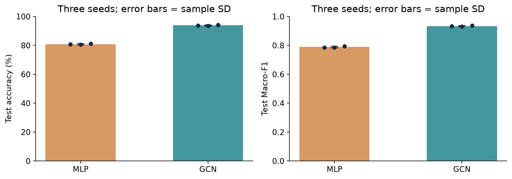

The comparison summarises the matched runs, including their variability; it does not show uncertainty across independent data splits. Classification improvement and successful routing of uncertain cases are separate outcomes.

## 2. Data, preprocessing and leakage controls

The course-linked [Facebook Page-Page mirror](https://github.com/gayanku/facebook_page-page_dataset) provides **22,470 nodes and 128 finite features per node**. The Version 2.5 specification (Section 2.1 and Appendix A.6) explicitly directs students to this modified Gayanku FacebookPagePage source because the original link is unavailable. This is already the source used for all recorded experiments; the clarification requires no dataset substitution or retraining. Class counts are tvshow 6,495; government 6,880; company 5,768; politician 3,327. Features are a supplied SVD compression of 4,714 description-token indicators; their upstream construction is not claimed as training-only.

The archive is pinned to commit `ec01d02c39da4385052023ed28e36f0794f61dc8`, SHA-256 `7a1b8a0687515e9859d1ca649dc276825f5db44568894dfbb6b55ebc1cf6a9c1`. Because its numeric keys differ from the standard PyG loader, `dataset.py` constructs `torch_geometric.data.Data` explicitly, without loading pickled page names. The audit validates dimensions, labels, finite values, endpoints and edges.

There are 342,004 raw edge entries, including 179 duplicates and 358 self-loops. Deduplication, symmetrisation and loop removal produce 341,646 non-self directed entries (both directions included); GCN then adds one self-loop per node. Duplicate links thus do not receive extra weight. Standardisation uses training-node mean/standard deviation only; near-zero deviations use scale one.

| Fixed stratified split | Nodes | Use |
| --- | ---: | --- |
| Training | 13,481 | Cross-entropy optimisation |
| Validation: model selection | 2,245 | Checkpoint and early stopping |
| Validation: calibration | 2,248 | Temperature and threshold fitting |
| Test | 4,496 | Final evaluation and post-evaluation inspection |

The 60/20/20 split uses per-class flooring and seed 42; role seed 43 partitions validation by class. Tests verify exhaustive, disjoint, reproducible splits and class coverage.

This is **transductive classification**: all features/edges are available, including unlabelled validation/test nodes. Labels never enter inputs or messages. Only training labels enter optimisation; selection/calibration labels serve separate roles. In the original protocol, test labels did not choose settings, checkpoints or thresholds. The later 97% objective was selected after the original test results had been inspected; its thresholds use calibration labels only, but its reused-test comparison is explicitly post-hoc. Inductive performance on new pages/graphs is untested.

## 3. Algorithm and implementation

GCN follows [Kipf and Welling](https://arxiv.org/abs/1609.02907). For binary symmetric adjacency A, define `S = D^(-1/2) (A + I) D^(-1/2)`, where D contains the row sums of `A + I`. Self-loops preserve the node's own signal; degree normalisation moderates neighbour contributions. The network computes `H = ReLU(S X W0 + b0)` and `Z = S Dropout(H) W1 + b1`. Two aggregation layers expose a node to two-hop feature context; neighbourhood labels are never supplied. Biases are added after aggregation.

Both networks use **128 -> 64 -> 4**, ReLU, dropout 0.5 and **8,516 parameters**. MLP removes S, treating nodes independently; aggregation is the main architectural difference. `modules.py` uses native PyTorch layers and sparse multiplication, without NumPy or prebuilt PyG convolutions. PyG supplies the data container; NumPy/scikit-learn support preprocessing/evaluation.

| File | Responsibility |
| --- | --- |
| `modules.py` | MLP, GCN and binary normalised sparse adjacency |
| `dataset.py` | Checksum-verified acquisition, validation, splits and training-only scaling |
| `train.py` | Explicit training loop, selection, calibration, metrics, checkpoint and profiling |
| `predict.py` | Reload saved weights, export predictions, embeddings and diagnostic figures |
| `evaluation.py` | Multiclass metrics, temperature fitting, ECE and original selective prediction |
| `policy97_experiment.py` | Separate fixed 97% policy fitting and post-hoc evaluation; no model retraining |
| `predict_with_policy.py` | Apply a checkpoint-bound policy and export label-free acceptance/review decisions |
| `validation_study.py`, `predict_study_policy.py` | Five disjoint label roles, new CPU training, class-aware comparison and saved-study prediction |
| `test_policy_controls.py` | Six policy failure-mode and experiment-protection checks |
| `exact_policy.py`, `refinement_study.py` | Exact confidence-tie search and three-seed class-weighted GCN comparison |
| `predict_refinement.py`, `test_exact_policy.py` | Bound-policy reload, optional random quality-review routing and six additional checks |
| `consensus_policy.py`, `consensus_study.py`, `predict_consensus.py` | Fixed six-model mean, separate calibration, disagreement ablation and label-free saved-policy replay |
| `audit_consensus.py`, `test_consensus_policy.py` | Selected-error node-isolation diagnosis and eight additional targeted checks |
| `audit_dataset.py` | Numeric dataset and split-provenance audit |
| `test_data_pipeline.py`, `test_models.py` | Six data/model correctness checks |

English docstrings explain purposes, functions and protocol boundaries. Six checks passed before formal runs, covering splits/class coverage, training-only scaling, invalid arrays, duplicate/self-loop handling, adjacency correctness, and permutation equivariance/finite gradients. These small synthetic fixtures test specific properties, not exhaustive correctness or the absence of every possible leakage path. The five-epoch CPU smoke runs and later saved-model reloads provide separate execution evidence. Neither software checks nor a decreasing training loss establish held-out quality or deployment safety.

## 4. Training, model selection and saved-model inference

Matched settings are Adam, learning rate 0.01, weight decay 0.0005, maximum 200 epochs, patience 30 and initialisation seeds **42, 43, 44**. Full-graph forwards compute training-masked cross-entropy. Selection Macro-F1 determines the checkpoint, restored before calibration/testing; losses and gradients must be finite.

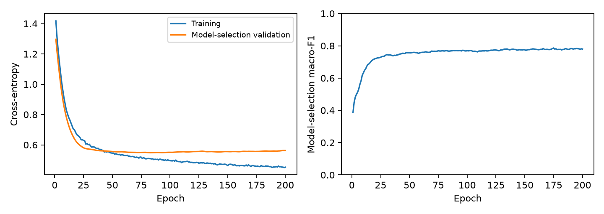

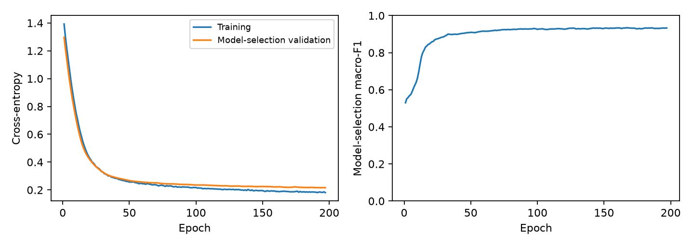

Loss falls for both models. The left panels show cross-entropy, while the right panels show model-selection Macro-F1; an improvement in one need not mean every other measure improves. GCN seed 42 selects epoch 167 and stops at 197; the last epoch is not necessarily best. All three runs are reported. Seeds change initialisation/stochastic training, **not the split**. Means/sample standard deviations describe optimisation variability, not confidence intervals or variation across independent splits.

Checkpoints save architecture, weights, checksum, seeds, scaling, temperature and threshold. `predict.py` verifies checksum/scaling, restores weights and uses evaluation mode without gradients; non-final checkpoints cannot evaluate test labels. Both seed-42 checkpoints were reloaded, exporting 4,496 predictions each; CSV accuracy agrees with saved evaluation.

## 5. Held-out classification results

Metrics below use raw softmax scores; positive temperature scaling preserves argmax labels, so accuracy, F1 and confusion counts are unchanged. AUROC is macro one-versus-rest; ranking scores can change slightly after multiclass probability rescaling.

| Model | Test accuracy (%) | Macro-F1 | Macro OVR AUROC |
| --- | --- | --- | --- |
| MLP | 80.77 +/- 0.45 | 0.7884 +/- 0.0054 | 0.94685 +/- 0.00029 |
| GCN | 93.84 +/- 0.32 | 0.9333 +/- 0.0032 | 0.99005 +/- 0.00038 |

| Model / seed | Epochs / best epoch | Test accuracy (%) | Macro-F1 | AUROC |
| --- | --- | --- | --- | --- |
| MLP / 42 | 200 / 175 | 80.63 | 0.7849 | 0.94658 |
| MLP / 43 | 148 / 118 | 80.40 | 0.7857 | 0.94683 |
| MLP / 44 | 200 / 194 | 81.27 | 0.7946 | 0.94715 |
| GCN / 42 | 197 / 167 | 93.75 | 0.9323 | 0.99007 |
| GCN / 43 | 144 / 114 | 93.57 | 0.9308 | 0.98966 |
| GCN / 44 | 200 / 190 | 94.19 | 0.9369 | 0.99042 |

### Per-class results and confusion analysis

The **prespecified seed 42** provides P/R/F1 (precision/recall/F1) below; overall accuracy can obscure smaller-class weaknesses.

| Class | Test n | MLP P / R / F1 | GCN P / R / F1 |
| --- | --- | --- | --- |
| tvshow | 1299 | 0.8336 / 0.8483 / 0.8409 | 0.9392 / 0.9269 / 0.9330 |
| government | 1376 | 0.7940 / 0.8685 / 0.8296 | 0.9323 / 0.9615 / 0.9467 |
| company | 1155 | 0.8165 / 0.8165 / 0.8165 | 0.9519 / 0.9602 / 0.9560 |
| politician | 666 | 0.7490 / 0.5781 / 0.6525 | 0.9190 / 0.8694 / 0.8935 |

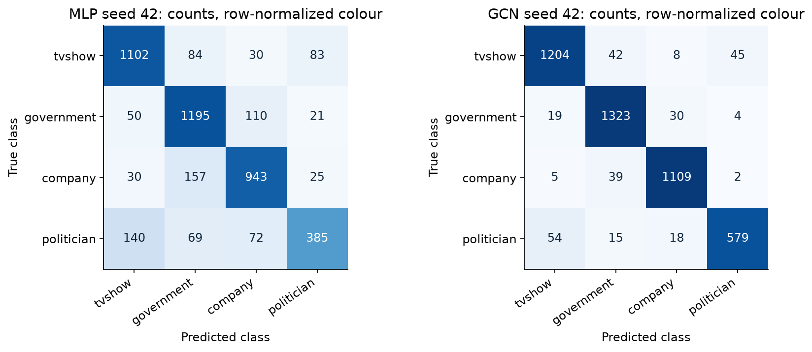

Matrix numbers are counts; colour is normalised within each true-class row. GCN improves all four class F1 scores over MLP. Politician is still weakest: recall 0.8694 means **87 of 666 politicians are missed**, including 54 predicted as tvshow. Conversely, 45 tvshow nodes are predicted as politicians. Each misclassification is a false negative for its true class and a false positive for its predicted class. Aggregate accuracy can mask class-specific errors.

## 6. Confidence, calibration and the reject-option limitation

The GCN outputs four logits, not a separate confidence or correctness head. Confidence is the maximum probability from `softmax(Z/T)`. This optional post-training temperature scaling follows Guo et al. (2017), Section 4.2, Equation 9 [Reference 3]. With the trained weights frozen, a positive scalar T is fitted by minimising cross-entropy on calibration nodes only (implementation range 0.05-20). T adjusts probability sharpness and preserves the predicted class; T=1 recovers ordinary softmax, T>1 softens and T<1 sharpens. T is distinct from the acceptance threshold: one rescales probabilities, the other routes predictions. Neither turns the score into a guaranteed correctness probability. ECE uses ten equal-width confidence bins, weighted by their population; it depends on binning and can conceal sparse-region errors.

| Model | Test NLL: raw -> scaled | Test ECE: raw -> scaled | Fitted T (42 / 43 / 44) |
| --- | --- | --- | --- |
| MLP | 0.5597 -> 0.5533 | 0.0345 -> 0.0400 | 1.163 / 1.087 / 1.171 |
| GCN | 0.2227 -> 0.2223 | 0.0250 -> 0.0161 | 0.866 / 0.847 / 0.875 |

These are held-out means. GCN ECE improves; MLP ECE worsens despite improved mean NLL. GCN seed-42 NLL slightly worsens (0.222336 -> 0.222389). Calibration optimisation guarantees no universal held-out improvement.

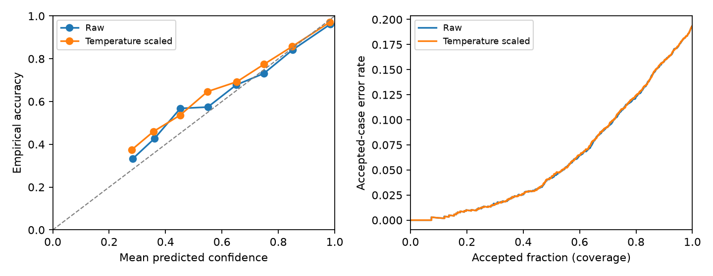

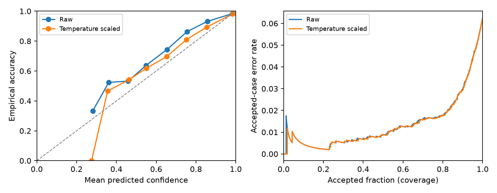

Reliability compares each populated bin's mean confidence with empirical accuracy; the diagonal is ideal. A point above the diagonal indicates underconfidence, and one below indicates overconfidence. Bin population matters: a sparse bin can fluctuate substantially, while ECE weights bins by their population. Risk-coverage plots sort predictions by confidence, showing accepted-case error against coverage, not training progress or a threshold on the horizontal axis. These test diagnostics do not define a new test-tuned policy. Near-diagonal regions coexist with near-certain errors. All fitted GCN temperatures are below one, so scaling sharpens rather than uniformly softens their predictions.

The implemented threshold grid is 0, 0.01, ..., 1.00. Candidates must accept at least `max(1, floor(0.05 * N_calibration))` nodes and achieve at least **90% empirical calibration accepted-case accuracy**. The objective maximises coverage, breaking ties towards the smallest threshold. If none qualifies, 1.01 rejects everything. The rule is empirical, without a statistical risk guarantee.

| Model / seed | Threshold | Test coverage (%) | Accepted test accuracy (%) |
| --- | --- | --- | --- |
| MLP / 42 | 0.63 | 71.82 | 90.06 |
| MLP / 43 | 0.63 | 71.22 | 90.54 |
| MLP / 44 | 0.62 | 73.58 | 89.66 |
| GCN / 42 | 0.00 | 100.00 | 93.75 |
| GCN / 43 | 0.00 | 100.00 | 93.57 |
| GCN / 44 | 0.00 | 100.00 | 94.19 |

**All GCN thresholds are zero.** Its full calibration set already exceeds 90%, so 100% coverage maximises the objective. This is the expected result of the chosen objective, not a numerical fitting fault. It nevertheless accepts low-confidence cases as well as confident mistakes and fails the intended ambiguity-routing goal. MLP rejects roughly 26-29%, but seed 44 accepted test accuracy is 89.66%, below the fitting target: calibration performance does not guarantee held-out performance.

### Original threshold experiment and subsequent decision record

| Item | Recorded finding or decision |
| --- | --- |
| Experimental objective | Fit on calibration data only; require at least 90% empirical accepted-case accuracy and maximise coverage under the stated grid rule. |
| Observed GCN outcome | Threshold 0 for all three seeds, 100% test coverage; every selected failure is accepted. |
| Engineering interpretation | The fitting objective is satisfied, but useful ambiguity routing is not. Analysis completion is not evidence of business-goal attainment. |
| Original result preserved | Keep the original 90% rule, code, weights, thresholds and results. The additional 97% policies are separate files fitted on calibration data; original-test reuse is labelled post-hoc. |
| Requirement clarification | Ed screenshots supplied on 29 October show the teacher asking how confidence is derived, then replying that the description seems fine and requesting the source of T. Reference 3 supplies that source. This is a methodological exchange, not a formal PR review or approval of the experimental 97%/98% targets. |
| Remaining unvalidated options | A statistical risk bound, explicit review budget or ambiguity-margin rule is not implemented. Independent confirmation of the new 97% policy also remains outstanding. |

The post-consultation documentation record is [reports/post_checkoff_record.md](reports/post_checkoff_record.md). It separates the student's reported check-off completion from unresolved interpretation of the final requirements.

### Post-hoc policy improvement - 26 October 2026

The chosen improvement is to require at least **97% empirical accepted calibration accuracy**, then maximise coverage with the same 0.01 grid and minimum-5% acceptance rule. This raises the formerly non-binding 90% objective; 97% is neither a confidence cutoff of 0.97 nor a course-mandated or statistical safety guarantee. Original weights, positive temperatures, split and class predictions remain unchanged. Scalar thresholds for seeds 42/43/44 are **0.73/0.76/0.74**. The code stores the policies separately rather than overwriting trained checkpoints or the original policy.

All three policies were fitted using calibration labels and saved with protocol/checkpoint hashes before this follow-up calculated reused-test metrics. However, the original test results had already been inspected when this new objective was selected. The following is therefore **post-hoc reuse of the original test**, not untouched evaluation or independent confirmation. The thresholds are kept fixed after these outcomes, including the failed target for seed 44.

| Seed | Threshold | Accepted / 4,496 | To human review | Coverage (%) | Accepted accuracy (%) |
| --- | ---: | ---: | ---: | ---: | ---: |
| 42 | 0.73 | 4,056 | 440 | 90.21 | 97.02 |
| 43 | 0.76 | 3,959 | 537 | 88.06 | 97.20 |
| 44 | 0.74 | 4,024 | 472 | 89.50 | **96.99** |

Mean referral is **10.74 +/- 1.10%** (percentage-point sample SD across the same initialisations), mean coverage 89.26%, and accepted-case accuracy **97.07 +/- 0.11%**. Original all-accept accuracy and unchanged whole-test model accuracy remain **93.84 +/- 0.32%**. The selective metric uses fewer, selected cases; it must not be presented as improved classification accuracy across the full test population. On average, 57.39% of original mistakes enter the review queue; no reviewer correction rate or final human-plus-model accuracy was measured.

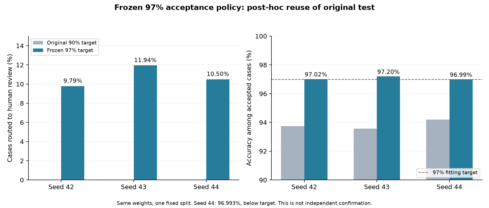

Seed 44's exact accepted accuracy is 96.9930%, below 97%; one-decimal rounding would conceal this shortfall. Even seed 42 still accepts **121 errors** while referring 160 of its 281 original errors. Politician accepted accuracy is only about **94.80-95.42%** across these runs, so the overall target is not a per-class guarantee. High-confidence errors can still pass. The main example remains the prespecified seed 42, rather than selecting seed 43 because it looks best in this follow-up.

For the five original failure cases in Section 8, seed 42's new rule refers ambiguous node **18785** (confidence 0.263498 < 0.73), while nodes 16052, 9254, 22382 and 953 remain accepted. This demonstrates routing of that near-tie; it does not resolve confidently wrong predictions or establish their cause. No threshold is changed in response to these inspected examples.

The [follow-up record](reports/policy97/README.md), [full aggregate/per-class results](reports/policy97/FOLLOWUP_RESULTS.json) and [frozen policies](policies) retain all outcomes and provenance. The new prediction entry point exports decisions without reference labels; checkpoint/data bindings and a CPU replay of 4,496 seed-42 predictions check implementation consistency. A future untouched evaluation remains necessary for independent policy confirmation. The original GPU profile does not measure the additional end-to-end policy/review workflow.

### Five-role robustness study and class-aware policy

To separate probability fitting from acceptance-policy fitting, a second study fixed split seed **20261026** before its final evaluation. Disjoint roles are **13,481 training, 2,245 selection, 2,245 temperature, 2,245 policy and 2,254 final nodes**. Scaling uses training features, selection Macro-F1 chooses checkpoints, temperature fits its own labels, and thresholds fit another role. Both matched MLP/GCN models were actually retrained on CPU for seeds 42/43/44 with the original architecture/hyperparameters. All six models/policies were saved and hash-recorded before final-role metrics; no settings were changed afterwards.

This is a **prospectively fixed within-graph resplit of previously studied data**, not new external data or restored project-level independence. The new test cases and weights differ from the original experiment: the original 93.84% benchmark and seed-44 96.99% selective result are retained. New-split numbers cannot be substituted for those results or interpreted as matched classification gains.

The Global97 control maximises policy-role coverage at 97% empirical accepted accuracy. The class-aware alternative, Class98, fits a threshold for each **predicted** class at 98% empirical accepted accuracy, a predeclared one-point fitting buffer above the desired 97%. Each class must retain at least `max(50, ceil(0.05 * predicted_class_policy_count))` cases; an infeasible class uses 1.01 and is fully referred. The same 0.01 threshold grid and smaller-threshold tie apply. Decisions do not receive true labels or known-error IDs. The buffer is heuristic, not a statistical guarantee.

| Study seed | Global97 review (%) | Global97 accepted accuracy (%) | Class98 review (%) | Class98 accepted accuracy (%) |
| --- | ---: | ---: | ---: | ---: |
| 42 | 18.54 | 97.82 | 30.97 | 97.94 |
| 43 | 15.66 | 97.53 | 30.79 | 97.88 |
| 44 | 17.57 | 97.74 | 32.17 | 98.10 |

Mean Global97 referral is **17.26%**, with **97.70%** accepted accuracy. Mean Class98 referral is **31.31%**, with **97.98%** accepted accuracy. The new models' full-population accuracy is **93.52%**, unchanged by the policy. All three observed accepted accuracies exceed the desired 97%; the 98% fitting buffer is not met by every final run/group, and no future guarantee follows. All six runs, including the lower-performing MLP controls, are retained in the [full study record](reports/five_role/README.md).

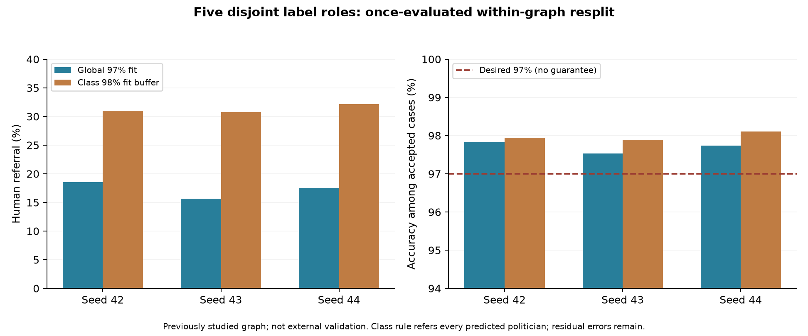

**Historical coarse-grid class-coverage failure.** No politician-prediction threshold on the 0.01 grid met Class98's fitting target/minimum in any GCN seed, so that rule refers all predictions of politician. The exact-search refinement below repairs this zero-coverage outcome while preserving the original grid results. Nonempty accepted predicted-class groups exceed 97% observed accuracy here, but **7/5/5 true politicians are wrongly accepted as other classes**. Accepted accuracy conditional on the true politician class is 0% in this candidate because none of the correct politician predictions is accepted. This exposes a serious true-class recall/coverage trade-off; it is not uniform class safety. The candidate still accepts **32/33/29 errors** across seeds. It is a conservative research alternative, not an unconditional deployment recommendation.

The study's saved-model CPU reload reproduces all 2,254 seed-42 predictions and routes (1,556 accepted; 698 referred), without reference labels in the output/decision function. **Twelve checks now pass**, including the original six and six new controls for malformed probabilities, class infeasibility, class-based routing, role separation, checkpoint mismatch and evidence-preserving output guards. The original 97% runner now verifies the actual dataset checksum, model/seed/split/calibration roles and positive temperature, and refuses partial-output overwrites. These safeguards repair identifiable implementation risks, not every possible defect or model error.

### Exact-threshold repair and weighted-loss ablation (post-hoc)

The grid jumps from 0.99 to 1.00 and can skip a useful interval just below one. `exact_policy.py` searches every distinct confidence boundary, keeping complete equal-score groups. It preserves the 98% empirical fitting target, minimum accepted count, maximum-coverage objective and all-refer fallback. Exact politician cutoffs are about **0.999611/0.999635/0.999750** on the policy role. Full precision is saved in JSON and required for use; displayed rounded values are not executable replacements. The policy-fitting subset now accepts 65/67/64 politician predictions at 98.46%/98.51%/98.44%; these are fitting statistics, not final scores.

Three additional CPU GCNs test weighted cross-entropy, using only training-label counts: `weight_c = N_train / (4 * n_train,c)`. The weights are approximately 0.864832/0.816437/0.974061/1.688502 in class order. Architecture, optimiser, initialisations, selection/early stopping and the five disjoint roles are unchanged. New temperatures fit unweighted NLL on the temperature role, and exact thresholds fit on the policy role. All six exact policies (three reused unweighted models and three weighted models) are frozen before this comparison. The final-role results were already inspected previously: **this is post-hoc controlled refinement, not independent confirmation**. No further settings are changed after these outcomes.

| Refinement | Whole accuracy (%) | Politician recall (%) | Coverage (%) | Accepted accuracy (%) |
| --- | ---: | ---: | ---: | ---: |
| Grid / unweighted | 93.52 | 87.26 | 68.69 | 97.98 |
| Exact / unweighted | 93.52 | 87.26 | 72.29 | 98.08 |
| Exact / weighted | 93.88 | 92.34 | 72.38 | 98.02 |

All rows use the same 2,254 final cases and three seeds. Exact search changes acceptance, not the predicted classes. Weighting raises mean politician recall by **5.07 percentage points**, while precision falls from **91.18% to 88.22%**. It is a measured recall/precision trade-off, not a universal improvement or evidence that class imbalance alone caused the errors. These numbers do not replace the original 4,496-case 93.84% benchmark.

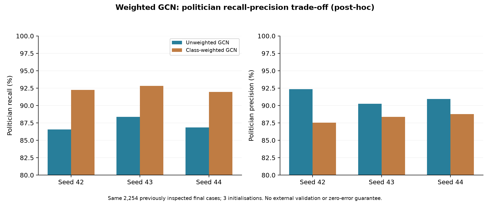

The exact unweighted policy now accepts **72/73/71 predicted politicians**, instead of zero under the grid rule; weighted exact accepts 68/64/71. Zero errors are observed in those narrow predicted-politician subsets, which does not guarantee future correctness or protect every true politician. True politicians wrongly accepted as other classes are **7/5/5 versus 5/6/5**; seed 43 worsens. Total accepted errors are **32/33/29 versus 31/34/32**, including **11/8/9 versus 7/8/8** with confidence at least .99. Weighted seed 43 accepted accuracy is **97.93%**, below the 98% fitting target, and is not retuned. Original failures remain part of the evidence.

An optional **label-free random quality-review sample** addresses the blind spot of reviewing only low-confidence cases, without assuming all errors are caught or human review is perfect. Both seed-42 saved-model reloads match all 2,254 stored predictions/routes. With unweighted exact and a 5% eligible-case audit, 1,630 pass the threshold, 624 need threshold review, and another 82 are sampled for quality review, leaving 1,548 automatic candidates. The table reports threshold-only coverage; audit workload is additional. No human correction outcome is measured.

At the exact/weighted refinement stage, **18 targeted checks passed**, including narrow score intervals, indivisible ties, class-weight provenance and reproducible audit sampling. The [full refinement record](reports/refinement/README.md) preserves every seed, full-precision policies, raw/calibrated metrics and limitations. The default new replay uses the prespecified unweighted seed 42; weighted runs are explicit comparison options. External validation still needs compatible new data.

### Six-model confidence and disagreement ablation (post-hoc)

A high politician cutoff is not itself proof that every politician prediction is overconfident. More importantly, a true politician assigned confidently to tvshow is checked against the tvshow cutoff. To investigate this blind spot, a final **fixed six-member comparison** reuses all three unweighted and all three weighted GCNs, without retraining or selecting members by their final scores. Averaging follows the general ensemble idea in Lakshminarayanan et al.; this mixed-loss GCN pool and unanimity rule are project-specific, not a reproduction of that paper.

The equal mean of member-temperature-scaled probabilities is recalibrated with one positive scalar on the temperature role only (T = 0.971650). Exact class thresholds are fitted on the separate policy role at the unchanged 98% empirical target/minimum size. Both a threshold-only rule and a rule requiring all six argmax votes to agree are saved before comparison. The latter fits thresholds only among eligible policy cases. Full precision and provenance are preserved. The final cases have already been inspected, so **this entire comparison remains post-hoc**; no new independent validation is claimed and no rule is selected by its final score.

| Consensus candidate | Coverage (%) | Accepted accuracy (%) | Accepted mistakes | Missed politicians accepted |
| --- | ---: | ---: | ---: | ---: |
| Single unweighted GCN / seed 42 | 72.32 | 98.04 | 32 | 7 |
| Six-model mean + thresholds | 71.74 | 98.21 | 29 | 5 |
| Mean + thresholds + unanimity | 71.74 | 98.21 | 29 | 5 |

All rows use the same 2,254 reused final cases. The six-model rows describe **one ensemble**, not three independent runs or a replacement for the original 93.84% benchmark. Whole-population accuracy is 93.74%, politician precision/recall 89.58%/89.85%. Each ensemble rule accepts 1,617 cases, refers 637 and retains 29 mistakes; 69 predicted politicians are accepted with no observed error in that small subset. Accepted mistakes at confidence >= .99 fall from 11 to 8, but a true politician with >= .99 confidence is still wrongly accepted. These observations do not imply future class safety.

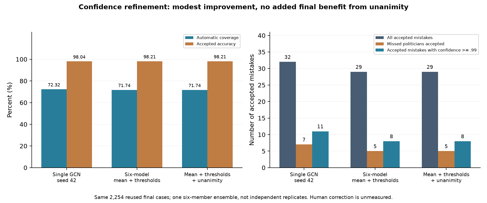

There are 94 final cases with disagreement, but all are already rejected by the ensemble's fitted thresholds. **Unanimity therefore adds no observed final-case benefit or extra referrals.** The two recovered baseline politician mistakes (1958 and 5152) are rejected after probability averaging, although all six votes still say tvshow: they are not successes of the disagreement gate or confirmed human corrections. The other five missed politicians remain automatically wrong. All outcomes are retained; no further final-score tuning follows.

| Confidence diagnostic | Single GCN / seed 42 | Six-model calibrated mean |
| --- | ---: | ---: |
| Whole-population NLL | 0.23100 | 0.22217 |
| Top-label ECE / 10 bins | 0.02507 | 0.02334 |
| Politician one-vs-rest Brier | 0.02418 | 0.02275 |
| Politician one-vs-rest ECE / 10 bins | 0.01191 | 0.01298 |

Lower is better for these diagnostics. NLL, top-label ECE and politician Brier improve, while politician ECE worsens. Predicted-politician mean confidence is 89.51% against observed precision 89.58%; an average match does not validate the extreme-confidence tail. Two >= .99 false-positive politician predictions and one >= .99 missed true politician remain. Binary ECE includes many negatives, is bin-sensitive, and graph observations are correlated; it is not a per-case guarantee. Calibration can sharpen probabilities here (T < 1) and need not lower every wrong score.

Five selected baseline missed-politician cases receive an additional autopsy in the [complete consensus record](reports/consensus/README.md). Node 909 remains tvshow at 99.45% despite unanimous votes. Its 90 training-labelled neighbours include 53 tvshow and 20 politician pages, but its three nearest training feature vectors are politicians. The feature-only MLP also predicts tvshow at 52.26%. Removing only this node's incident nonself edges, renormalising and keeping unweighted seed-42 weights fixed still predicts tvshow at 99.93%. Thus neither neighbour majority nor ensemble agreement proves correctness, and neighbour removal does not resolve this case. In contrast, isolated node 1958 flips to politician at 99.55%, demonstrating graph sensitivity for that selected case. These interventions diagnose model response under changed inputs, not the data-generation cause, annotation error or a validated deployment modification. No diagnostic labels/IDs enter routing.

The full 26-test suite passes, including a test demonstrating that all models can share a confident error. Two new label-free replays match all 2,254 saved predictions/decisions; altered policy/checkpoint artifacts are rejected before export. Optional 5% random quality review adds 81 reviews among the ensemble's 1,617 eligible cases, leaving 1,536 automatic candidates. This workload is additional; no human correction is measured. See [verification notes](reports/verification_guide.md) for what each check establishes and [assessment alignment](reports/assessment_alignment.md) for current evidence and external pending items.

## 7. Embedding visualisation and interpretation

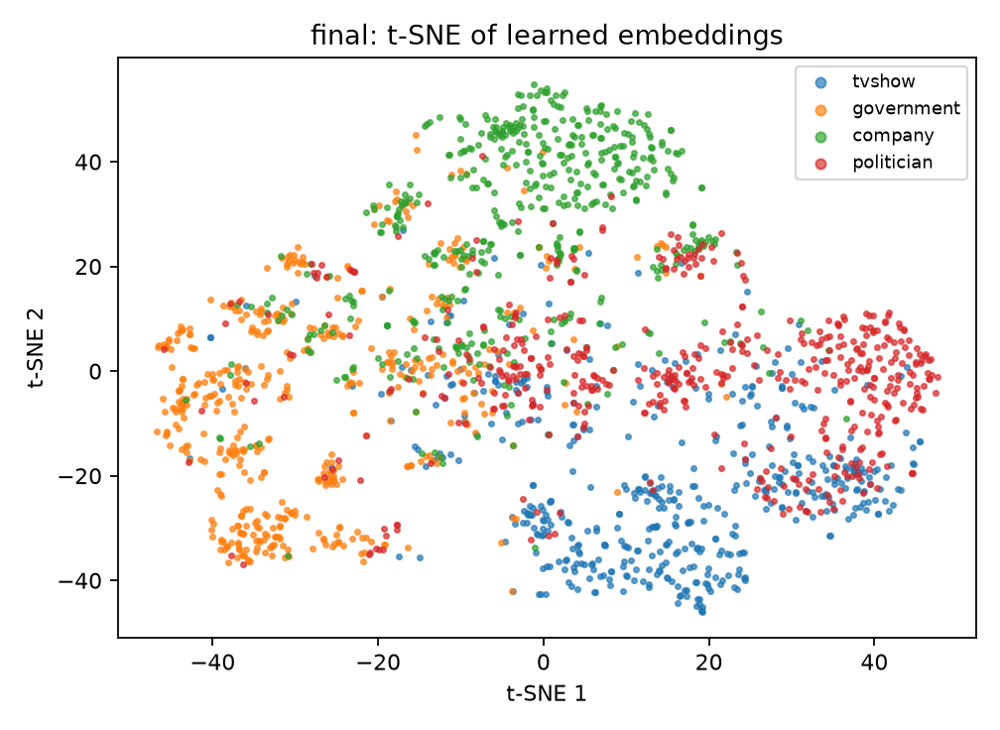

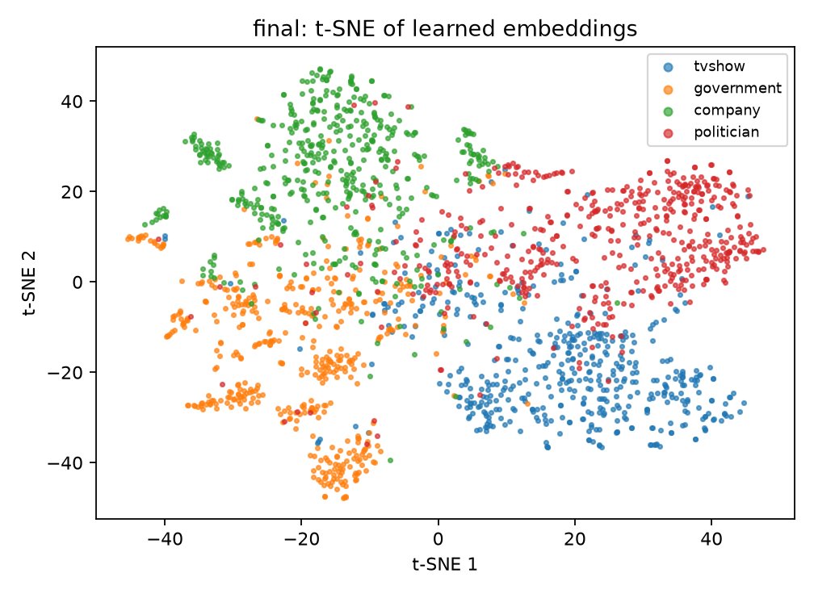

These t-SNE plots use test-node 64-dimensional hidden representations, ground-truth colours, up to 500 randomly selected points per class, seed 42, PCA initialisation, automatic learning rate and perplexity 30. Both show broad class-associated regions, including a company-dominated region and substantial mixed central areas. The GCN plot shows a more distinct politician-dominated region, but tvshow/politician and other boundary mixing remains, consistent with the confusion matrix. This is qualitative support only. Separate projections make coordinates and distances incomparable between models; t-SNE can distort global geometry, the class-balanced sample changes apparent density, and visual separation does not measure accuracy or prove the mechanism of improvement.

## 8. Five real failure autopsies

Cases come from the fixed seed-42 GCN test predictions. The selection rule samples high confidence, low degree, low margin and high degree before filling unique cases; it is not a random error sample. Confidence below is temperature-scaled. Under the original 90% policy, all five are accepted because the GCN threshold is zero; the separate 97% policy's routes are compared in Section 6.

The student reports that the tutor suggested adding failure analysis to the experimental record. The following retains that failure record using the original predictions and diagnostics. The separate 26 October policy experiment is distinguished in Section 6; neither record claims formal teaching-team approval.

| Node | True -> GCN | GCN confidence | Degree | MLP prediction / confidence / accepted |
| --- | --- | --- | --- | --- |
| 16052 | government -> company | 1.000000 | 266 | company / 0.906357 / True |
| 9254 | tvshow -> politician | 1.000000 | 16 | politician / 0.993158 / True |
| 22382 | politician -> tvshow | 0.815955 | 1 | company / 0.563093 / False |
| 18785 | politician -> government | 0.263498 | 2 | government / 0.408311 / False |
| 953 | tvshow -> company | 0.999799 | 4 | politician / 0.344795 / False |

1. **16052: confident neighbourhood conflict.** **Evidence:** degree 266; all 161 training-labelled neighbours are company, 99.6% of neighbours are predicted company, and both models misclassify it as company. **Hypothesis:** feature and neighbourhood context may reinforce the wrong category. **Limit:** the MLP error prevents attributing the failure to graph aggregation alone; neither a semantic trigger nor an incorrect annotation is established. **Future action, unvalidated:** inspect original content/annotation and perform a controlled feature-versus-topology ablation on an independent evaluation protocol before deciding the cause.
2. **9254: near-certain error.** **Evidence:** all eight training-labelled neighbours are politicians, although the node is labelled tvshow; both models predict politician, and temperature scaling increases GCN confidence to approximately one without correcting its class. **Hypothesis:** shared feature/context ambiguity may drive the error. **Limit:** neither high confidence nor neighbour agreement proves the prediction correct, and no page-text evidence identifies the ambiguity. **Future action, unvalidated:** audit original content and study high-confidence errors under a separately validated review rule.
3. **22382: sparse local support.** **Evidence:** the single non-self neighbour has a training tvshow label; GCN predicts tvshow at 0.816, while MLP predicts company and refers the case. **Hypothesis:** sparse context may leave the representation sensitive to one neighbouring page. **Limit:** one example and the MLP error cannot establish that low degree caused the failure. **Future action, unvalidated:** evaluate degree-stratified error rates and controlled edge perturbations using independent evaluation data.
4. **18785: explicit ambiguity missed by policy.** **Evidence:** GCN predicts government at 0.2635, with a top-two margin of 0.0015; degree is two, and its one training-labelled neighbour is politician. MLP also predicts government but refers it. **Hypothesis:** the near-tied scores indicate insufficient class separation. **Limit:** the scores establish ambiguity, not its semantic cause, and do not determine a justified replacement threshold. **Future action, unvalidated:** predefine a margin or review-budget criterion and validate it separately. The original all-accept policy demonstrably misses this ambiguity; the separate seed-42 97% policy now refers this case, with the post-hoc limitation stated in Section 6.
5. **953: confident error with mixed labelled context.** **Evidence:** degree four; one training neighbour is tvshow and one company, yet all neighbours' predicted labels agree with company. GCN predicts company at 0.9998; MLP predicts politician at 0.3448 and refers it. **Hypothesis:** local representation/prediction agreement may reinforce the wrong class. **Limit:** prediction agreement is not ground truth, and the differing MLP error does not isolate a causal graph effect. **Future action, unvalidated:** inspect content and compare feature/topology ablations before choosing an intervention.

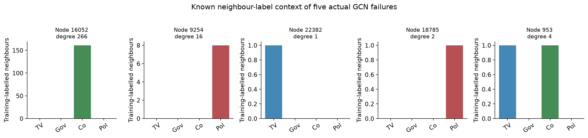

The plot counts only neighbours with training labels; those labels are used for post-evaluation diagnosis, never as model inputs or messages. Counts are not normalised and the very different node degrees should be considered. Without page text/names or controlled interventions, semantic triggers, annotation mistakes and causal mechanisms remain unverified. The five selected cases support reporting, not prevalence estimates or further tuning on this test set. Every future action above remains proposed work.

## 9. Computational cost and measured scope

Formal experiments ran on **Rangpur, NVIDIA A100-PCIE-40GB**, driver 590.48.01, Slurm job 680694, partition `a100-test`, shared allocation `shard:1` and two requested CPUs. These are actual measurements, not the preliminary budget.

| Measured quantity | MLP | GCN |
| --- | --- | --- |
| Parameters | 8,516 | 8,516 |
| Peak allocated GPU memory (MiB) | 48.27 | 82.98 |
| Peak reserved GPU memory (MiB), seeds 42/43/44 | 56 / 64 / 64 | 96 / 96 / 96 |
| Full-graph forward median (ms), mean +/- SD | 0.293 +/- 0.006 | 0.780 +/- 0.001 |
| Training loop seconds, mean +/- SD | 2.992 +/- 1.414 | 2.949 +/- 0.589 |

Each run's forward time is the median of ten full-graph passes after three warm-ups, with CUDA synchronisation, evaluated on all 22,470 nodes. It excludes loading and adjacency construction; it is neither per-node nor end-to-end request latency. Reported mean/SD aggregates those three medians. GCN costs about 2.66 times the forward time and 1.72 times the allocated memory of MLP, while both remain small in absolute terms here.

PyTorch peaks cover training, calibration and forward profiling before test metrics; they exclude other users' allocations and are not total device occupancy. Training time includes epoch validation/checkpoint copying, excluding data/adjacency setup, calibration and plotting. Different stopping epochs, cold starts and sharing prevent claiming faster GCN training. The running job snapshot is historical; later terminal evidence shows the session ended and the user's queue empty after download.

The additional six-model study is profiled separately on CPU with four threads and prepared full-graph inputs. One GCN takes median 78.108 ms, versus 486.365 ms for six forwards plus averaging/calibration/agreement (6.23x); the pool stores 51,096 parameters versus 8,516. Ten repetitions follow three warmups. This excludes file loading, graph construction, training and human review; it is not comparable directly to the A100 timings above. Ensemble GPU VRAM/latency has not been remeasured.

## 10. Reproduction and example usage

Run commands from `recognition/Facebook_GCN/`. First install an appropriate PyTorch CPU/CUDA build, then `python -m pip install -r requirements.txt`. The actual formal environment was **Python 3.11.15; PyTorch 2.13.0 (`+cu130` reported at runtime); CUDA 13.0; torch-geometric 2.8.1; NumPy 2.4.6; scikit-learn 1.9.1; matplotlib 3.11.2**, Linux x86-64/glibc 2.28. `requirements.txt` permits a wider compatible range; for matching runs pin these direct versions with a suitable PyTorch wheel. Hardware/library changes may affect numerical results and timing; seed settings do not guarantee bitwise equality.

```bash
python audit_dataset.py --download
python -m unittest discover -v
python train.py --smoke --device cpu --epochs 5 --models mlp gcn
python predict.py runs/smoke/gcn_seed42/model.pt --split validation --embedding
```

Smoke mode caps training at five epochs and refuses test evaluation. For the unchanged formal protocol, use the same preset without tuning on the published test results:

```bash
python train.py --models mlp gcn --seeds 42 43 44 --device cuda --epochs 200 --evaluate-test
python predict.py runs/final/mlp_seed42/model.pt --split test --device cuda --embedding
python predict.py runs/final/gcn_seed42/model.pt --split test --device cuda --embedding
```

Input is the checksum-verified numeric archive, converted to `x: [22470,128]` and canonical `edge_index: [2,341646]`. Outputs include `model.pt`, `summary.json`, `history.csv`, `training.png`, then `predictions_test/predictions.csv`, `evaluation.json`, `confidence.png` and optional `embedding.png`. CSV fields are node ID, true/predicted numeric label, confidence and accepted flag; labels 0-3 follow tvshow/government/company/politician. Under the original saved policy, node 18785 yields predicted label 1, true label 3, confidence approximately 0.263498, accepted True.

Datasets, weights, environments and generated run folders are excluded from Git. Reproduce checkpoints locally or retain private backups; do not expect weights to be bundled in the PR. The unchanged Colab demo reads the original saved evidence by default; it is a baseline snapshot and does not include the 26 October follow-up. Regenerating its displayed tables/plots is not a new formal training run. Fresh prediction requires the saved checkpoint and dataset.

### Apply or replay the separate 97% policy

From this project directory, restore the original checkpoints and summaries under `runs/final/gcn_seed42`, `gcn_seed43`, `gcn_seed44` and the pinned dataset. Use the separate entry points:

```bash
python policy97_experiment.py --output runs/policy97_replay
python predict_with_policy.py --policy policies/gcn_seed42_policy97.json \
  --checkpoint runs/final/gcn_seed42/model.pt \
  --output runs/policy97_seed42_predictions.csv
```

The first command reproduces the explicitly post-hoc follow-up on CPU without retraining; use `--runs-dir` and `--data` for other private locations. The second applies the frozen seed-42 policy and exports `node_id,predicted_label,predicted_class,confidence,accepted,route,policy_id`, with route `automatic_candidate` or `human_review`. Reference labels are not exported or used for decisions, and no accuracy is calculated by this prediction command. Hash/seed/configuration/temperature mismatches are rejected. Existing outputs are not overwritten. Newly trained checkpoints require their own calibration-fitted policy; the supplied hashes bind these policies to the actual original weights. `predict.py` intentionally retains the old checkpoint policy. No dataset, checkpoint or per-node labelled follow-up export is added to Git.

### Reproduce the five-role CPU study

```bash
python validation_study.py --output runs/five_role_study
python predict_study_policy.py --study-dir runs/five_role_study \
  --run gcn_seed42 --policy class98 --output runs/study_routes.csv
```

This new study actually retrains six CPU models; the policy-reload command alone does not retrain. The study output must not already exist. The saved checkpoint, frozen policy files and split/scaling artifact are private prerequisites for the reload. Use `--policy global97` for the control. The CSV reports predicted label/class, confidence, acceptance, route and reason without ground-truth labels or calculated accuracy. See [reports/five_role](reports/five_role/README.md) for full scope, versions and preserved outcomes. The unchanged Colab continues to show the original baseline, not either additional study.

### Replay the exact/weighted refinement and quality-review sample

```bash
python refinement_study.py --base-study runs/five_role_study \
  --output runs/exact_weighted_study
python predict_refinement.py --study-dir runs/exact_weighted_study \
  --run unweighted_exact_seed42 --audit-fraction 0.05 \
  --output runs/exact_routes_with_audit.csv
```

The first command reuses three saved unweighted models and trains three weighted CPU models. The second only reloads; it verifies policy/checkpoint/protocol/dataset/split bindings and exports routes/reasons without reference labels. Use a new output path; private weights and scaling/split artifacts are prerequisites. `--run weighted_exact_seed42` selects the weighted comparison. `--audit-fraction 0` preserves threshold-only routing, while a positive fraction adds random quality reviews among eligible cases. This does not measure or assume human correction. See [reports/refinement](reports/refinement/README.md) for full precision, count accounting and the post-hoc boundary.

### Replay the six-model confidence comparison

```bash
python consensus_study.py --base-study runs/exact_weighted_study \
  --output runs/consensus_study
python predict_consensus.py --study-dir runs/consensus_study \
  --policy unanimous --audit-fraction 0.05 --output runs/consensus_routes.csv
```

The study reloads six existing models; it does not train. Replay uses the frozen `members/` artifacts and exports confidence, six votes, agreement, threshold and review reason without reference labels. Use `--policy mean_only` for the comparator or `--audit-fraction 0` for no random sampling. The private consensus backup includes required checkpoints, policies, split/scaling and executed sources; raw data remains separate. `audit_consensus.py` is an explicitly post-evaluation diagnostic requiring the same-split MLP backup, not a production routing dependency. All outputs require new paths.

## 11. Engineering recommendation and remaining limitations

Choose GCN for the next assisted-classification prototype: its accuracy/F1 gain is substantial on this split for modest absolute inference/memory cost. The separate 97% policy provides a concrete review queue while preserving the original benchmark. The five-role study strengthens separation of fitting roles. Exact score search repairs its coarse-grid zero politician coverage; weighted training further raises politician recall but lowers precision and does not consistently reduce accepted errors. Optional random quality review monitors eligible cases with additional human cost. Neither is independently confirmed on new external data. The six-model mean modestly improves selected outcomes, but costs about 6.23x CPU latency and unanimity adds no observed final benefit. Retain the single-GCN exact-policy replay as the simpler default research baseline, and keep the ensemble as a documented comparison rather than automatically adopting it from post-hoc scores. Shared high-confidence errors require content/annotation investigation and genuinely new validation, not repeatedly raising current cutoffs. Prioritise untouched evaluation, class-specific politician errors, and high-confidence mistakes before treating it as a deployment rule. MLP is a cheaper fallback when graph access is unavailable, though its quality is substantially lower here.

External validity remains limited by one graph, one random split, globally supplied features, no inductive/time-shift evaluation, one small architecture and no extensive hyperparameter search. Three initialisations do not replace repeated splits. Small-bin ECE and five selected failures cannot establish deployment safety. The additional within-graph resplit does not remove this project-level data reuse; genuinely independent external or temporal evaluation is still unavailable. The 97% policy is implemented as a transparent post-hoc extension; independent policy confirmation, statistical risk control and human-review effectiveness remain unestablished.

### Measured status of the five acceptance criteria

| Criterion | Evidence and status |
| --- | --- |
| Data integrity and split controls | Audit and six targeted checks completed; selected properties verified, not a proof against every possible defect or upstream leakage. |
| Matched benchmark | Completed for MLP/GCN, three initialisations on one fixed split, with per-class metrics, Macro-F1 and AUROC. |
| Confidence and review analysis | Original calibration/threshold analysis completed, with failed routing under threshold zero preserved. Original all-accept and first 97% outcomes are retained. Five-role, exact-threshold and weighted comparisons report coverage/accuracy and residual errors; twenty-six checks, label-free replays and a no-incremental-benefit consensus ablation support specific properties. Future/per-class guarantees and external confirmation remain unestablished. |
| Interpretation and failures | Two t-SNE views and five evidence-led failure analyses completed; original causal explanations remain hypotheses. New selected-error edge isolation measures model sensitivity only, not the true data-generation cause. |
| Resources and reproduction | Parameter counts, synchronised forward timings, GPU allocator peaks and checkpoint reloads recorded. GCN 82.98 MiB is below the original 4 GiB planning target; deployment-scale and dedicated-device performance are untested. |

## 12. Historical one-page feasibility review - 15 October 2026

The following preserves the **preliminary** review; its unfinished-experiment statements describe 15 October, not current results. The original editable version is [feasibility_review_draft.md](feasibility_review_draft.md). The [updated review dated 21 October](feasibility_review_current.md) preserves the status known when it was written. Check-off is now completed (student-confirmed); both dated reviews remain historical snapshots without retrospective changes. The update is recorded in [reports/post_checkoff_record.md](reports/post_checkoff_record.md).

**Project:** Confidence-aware Facebook Page Classification - Normal GNN

**Working draft - 15 October 2026.** Data and short CPU checks are complete. Tutor check-off and formal experiments remain outstanding.

**Scope and user need.** Build a Normal-difficulty node-classification prototype that helps a reviewer categorize Facebook pages and refer uncertain predictions for manual review. Investigate whether a multi-layer GCN provides more useful and reliable predictions than a feature-only MLP at an acceptable resource cost.

**Proposed data and model.** Use the course-linked FacebookPagePage mirror, with 128-dimensional SVD features and four classes, converted to native PyG Data. Compare a two-layer GCN with a feature-only MLP; both use hidden width 64 and have 8,516 parameters. GCN adds normalized neighbour aggregation, linking the project to graph structure, matrix operations and semi-supervised learning. Use fixed stratified train/validation/test splits. Split validation further into model-selection and calibration roles. The transductive model uses all node features and edges, but only training labels enter optimization; labels are never messages or input features.

**Acceptance criteria.**

1. Verify dataset dimensions and edge validity, and demonstrate that the saved split is reproducible, exhaustive and disjoint.
2. Train both models and report per-class precision/recall/F1, macro-F1 and AUROC on the same held-out split. Diagnose the outcome whether or not GCN improves on MLP.
3. Select a confidence threshold using validation data and report held-out coverage and accepted-case error. Compare confidence reliability between the models.
4. Provide an interpreted t-SNE/UMAP visualization and explain 3-5 actual failure cases.
5. Measure parameter count, inference time and GPU memory. The planning budget is one GPU with a 4 GiB peak-memory target; this remains unmeasured and does not assume particular hardware availability.

**Preliminary evidence.** Data audit: 22,470 nodes, 128 finite float32 features, four classes and 342,004 raw edge entries. Seed 42 gives 13,481/4,493/4,496 training/validation/test nodes without overlap; validation contains 2,245 selection and 2,248 calibration nodes. All six software tests passed. Five CPU epochs reduced MLP training loss from 1.421 to 1.082 and GCN loss from 1.393 to 1.069. Both saved models were reloaded successfully. These checks establish execution feasibility, not final quality. The 4,496-node test set remains unevaluated. Source checksums, splits, versions and short-run evidence are saved with the project.

**Risks, budget and fallback.** Main risks are leakage, oversmoothing and overconfident errors. Keep labels out of message passing, use training-only feature scaling, and use MLP as the operational fallback if graph context adds insufficient value. Canonicalize duplicate/self edges before GCN normalization. The new Virtual GPU Lab has a finite quota; Rangpur is another option. CPU feasibility checks used no school GPU time. Check the actual GPU and package environment before longer jobs.

**Next steps and schedule.** Discuss this review with the tutor and record check-off, then run matched experiments across three initialization seeds, inspect confidence and failures, and complete the report. The course profile lists 19-30 October 2026; confirm the individual lab slot, midpoint requirement and precise submission time. Include this review in the final README.

**References:** Kipf and Welling (2017), GCN; course-linked data mirror `gayanku/facebook_page-page_dataset` (Appendix A.6).

## 13. Submission status

The modular implementation, experiments and backups are complete. This README includes the final evidence and historical feasibility review, checked against Version 2.5. [PR #9](https://github.com/shakes76/PatternAnalysis-2026/pull/9) remains open against upstream `topic-recognition` with progressive commits. Feasibility check-off is completed (student-confirmed). At the 29 October, 18:06 Brisbane check, GitHub showed no formal reviews, inline comments or discussion comments. In supplied Ed screenshots, Gayan Kulatilake first asks whether the GNN predicts confidence, then says the description seems fine and asks for the source of T. Section 6 and Reference 3 explain that source and distinguish calibration from rejection. A reply citing the paper has been prepared; posting or a further response is not established. This exchange is not a formal code review or grading approval. The Turnitin receipt has not been provided. The Normal project does not meet the Hard-only criterion. The 26 October routing, weighted-training and consensus studies retain all original results, twenty-six targeted checks and unresolved high-confidence errors. This 29 October revision clarifies documentation only; it changes no models, policies, scores or Colab. No external validation or measured human correction is claimed.

## Artificial Intelligence Usage Disclosure

**ChatGPT and Codex** provided substantial assistance with interpreting requirements, finding/checking references and the course data link, planning experiments, scaffolding and refining data/model/training/evaluation code and tests, debugging environment/SSH issues, preparing plotting and reporting material, interpreting results, and producing the Colab/tutor preparation material. This is broader than autocomplete; it is not represented as wholly independent manual coding. The GCN formulation is attributed to Kipf and Welling, and dataset handling to the cited course/PyG sources.

Verification included the checksum/data audit, leakage and graph-normalisation checks, six passing software tests, five-epoch CPU feasibility runs, actual six-model Rangpur experiments, checkpoint reloading, prediction-CSV consistency checks and inspection of saved plots/errors. These checks verify particular properties, not every possible defect or deployment safety. The student remains responsible for understanding and explaining every submitted operation, loss and metric; AI-generated explanations must be checked against code and evidence. The original threshold-zero limitation and calibration regressions remain disclosed. AI also assisted with the separate 26 October 97% policy proposal, code, CPU analysis, provenance checks and documentation. Frozen policy hashes, unchanged original-source/checkpoint hashes, label-free replay, error-count accounting and negative binding checks verify specific properties. Seed 44's shortfall and post-hoc evaluation status are retained. AI also assisted with the prospectively fixed five-role study, actual CPU retraining/reload, class-aware alternative and additional controls. All results and residual errors are disclosed. AI additionally assisted with the exact-search implementation, training-only inverse-frequency weights, three new CPU GCN runs, label-free audit routing and eighteen checks. AI additionally assisted with fixed probability averaging, separate calibration, disagreement ablation, five-case feature/neighbour/edge-isolation diagnosis, CPU cost profiling, 26 tests and two negative integration checks. The absence of incremental benefit from unanimity, worsening politician ECE and the remaining shared high-confidence error are disclosed. Earlier zero-coverage and below-target outcomes remain historical records; no extension is presented as independent external validation or zero-error automation.

## References

1. COMP3710 teaching team. *Final Report Assessment*, Version 2.5, 2026, Sections 2.1 and 3-6 and Appendix A.6; supplied document checked on 26 October. Relative to Version 2.4, the relevant GNN, check-off, submission and marking requirements are unchanged; the added MambaIRv2 test link concerns another project.
2. T. N. Kipf and M. Welling. *Semi-Supervised Classification with Graph Convolutional Networks*. ICLR, 2017. [Paper](https://arxiv.org/abs/1609.02907).
3. C. Guo, G. Pleiss, Y. Sun and K. Q. Weinberger. *On Calibration of Modern Neural Networks*. ICML, PMLR 70:1321-1330, 2017. Section 4.2, Equation 9: temperature scaling. [Paper](https://proceedings.mlr.press/v70/guo17a/guo17a.pdf).
4. PyTorch Geometric. [FacebookPagePage documentation](https://pytorch-geometric.readthedocs.io/en/latest/generated/torch_geometric.datasets.FacebookPagePage.html) and [loader source](https://pytorch-geometric.readthedocs.io/en/latest/_modules/torch_geometric/datasets/facebook.html).
5. Course-linked [Facebook Page-Page numeric dataset and preprocessing description](https://github.com/gayanku/facebook_page-page_dataset), pinned commit and checksum in Section 2.

6. Y. Geifman and R. El-Yaniv. *Selective Classification for Deep Neural Networks*. NeurIPS, 2017. [Paper](https://proceedings.neurips.cc/paper/2017/hash/4a8423d5e91fda00bb7e46540e2b0cf1-Abstract.html). Cited for the coverage/error trade-off; its statistical guarantee is not implemented here.

7. PyTorch contributors. *CrossEntropyLoss*, official documentation. [Class weights](https://docs.pytorch.org/docs/2.14/generated/torch.nn.CrossEntropyLoss.html). Inverse-frequency weighting is an experimental training choice here, not a guarantee of improved class recall or calibration.

8. B. Lakshminarayanan, A. Pritzel and C. Blundell. *Simple and Scalable Predictive Uncertainty Estimation using Deep Ensembles*. NeurIPS, 2017. [Paper](https://papers.nips.cc/paper_files/paper/2017/hash/9ef2ed4b7fd2c810847ffa5fa85bce38-Abstract.html). Cited for probability averaging; this mixed-loss GCN pool and unanimity gate are a project-specific ablation.
